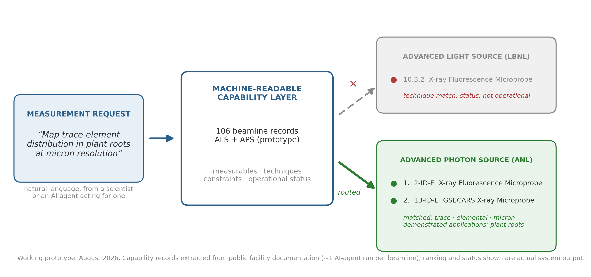

# The Instrument Capability Graph

*Machine-readable capability records for scientific instruments, and a matchmaker that routes measurement requests to the best operational instrument across facilities*



What a scientific facility can do is written down for people: beamline web pages, PDF specifications, proposal systems that assume a human has already chosen the instrument. An AI system planning an experiment needs the same information in a form it can compute over — *what can this instrument measure, on what samples, under what constraints, and is it operational today?* Mature pieces exist (the PaNET technique ontology, NeXus/NXDL data-format contracts, the European wayforlight catalog; [survey below](#documents)), yet none answers that question for an individual instrument in its current configuration, and none puts a matching layer over the answer.

As a feasibility test, we built one: a capability catalog that began with the beamlines of the Advanced Light Source and the Advanced Photon Source (106 records at the time of the SCAC input below; 326 now), extracted by AI agents from public documentation at roughly one agent-run per instrument, with per-field provenance on every record. A matchmaker resolves natural-language measurement requests against the catalog. All five DOE light sources are covered — ALS, APS, [NSLS-II](browse.html?q=NSLS-II) (30 beamlines), [SSRL](browse.html?q=SSRL) (29 stations), [LCLS](browse.html?q=LCLS) (9 FEL instruments, statuses from the current Run 27 proposal call) — along with both neutron sources ([SNS](browse.html?q=SNS), 20 instruments; [HFIR](browse.html?q=HFIR), 12), [EMSL](browse.html?q=EMSL) (29 flagship instruments from the 21-tesla FTICR to NanoSIMS), the [Molecular Foundry](browse.html?q=Molecular%20Foundry) (seven facilities plus NCEM's TEAM microscopes), and [CNM](browse.html?q=CNM) (five capability groups plus flagships from the chromatic-aberration-corrected ACAT to the XTIP synchrotron-STM beamline). The SCAC input's extrapolation — that the whole complex follows the same recipe — is what this page now demonstrates.

The catalog has since grown past beamlines. It carries records for the 19 instruments of [PoLARIS](https://pcl-polaris.org), the NSF Programmable Cloud Laboratory node for polymer science led from UChicago with Argonne — the first PCL node in the graph; robotic synthesis, formulation, and characterization platforms rather than beamlines ([search "PoLARIS"](browse.html?q=PoLARIS); the node team is reviewing these records against vendor specifications). It covers Argonne's four [RAPID](browse.html?q=RAPID) autonomous laboratories (RPL, RAPID-200, RAPID-350, RAPID-446). A second PCL node has joined: [COAST at UCSB](browse.html?facility=COAST) (14 draft records from the node's instrument inventory, under review by the COAST team — flow chemistry, benchtop and in-situ NMR, automated purification, and a GPU pool). And it records computing alongside the instruments — the [ALCF fleet](browse.html?q=ALCF) (Aurora, Polaris, Sophia, Crux, the AI Testbed, and the Inference Endpoints service), [Perlmutter at NERSC, Frontier at OLCF](browse.html?q=exascale%20computing), and the [University of Chicago Research Computing Center](browse.html?q=RCC) (nine systems, Midway3 to the secure enclaves) — because an experiment campaign routes to compute the same way it routes to a beamline, and because a university center publishing into the same schema is the adoption path the SCAC input describes for institutions beyond DOE. Every record carries a building-level location; the [map view](browse.html?map=1) shows the catalog as national infrastructure, Berkeley to Oak Ridge.

**[Browse the catalog →](browse.html)** — faceted browsing of every record, with the matchmaker running client-side; try [the routing query](browse.html?q=trace%20element%20distribution%20in%20plant%20roots). Records carry program membership, which can overlap — CNM and APS 12-ID-B are [DOE facilities](browse.html?program=DOE) *and* [accessible via the NSF PCL node](browse.html?program=NSF%20PCL); filters are shareable URLs (`?facility=`, `?program=`, `?q=`, `?map=1`).

## Routing around a dead instrument

The classic instrument for mapping trace elements in plant roots is the ALS hard X-ray fluorescence microprobe, beamline 10.3.2. It is currently not operational. Because the records carry live status and span two facilities, the request routes instead to operational APS microprobes — GSECARS 13-ID-E first, whose demonstrated applications include plant roots:

```
QUERY: "trace element distribution in plant roots"
  1. [ 28.2] aps-13-id-e  13-ID-E GSECARS X-ray Microprobe
         status=operational  record_depth=deep
         techniques: micro-XRF, micro-XAFS, micro-XRD, fCMT
         matched demonstrated_applications: fluorescence, plant, roots, trace
  2. [ 26.7] aps-2-id-e  2-ID-E X-ray Fluorescence Microprobe
         status=operational  record_depth=deep
         techniques: XFM, XRF-CT, X-ray fluorescence laminography, micro-XANES
  ...
  (with --all: als-10.3.2 X-Ray Fluorescence Microprobe, status=not-operational)
```

The complex behaves as one instrument. On the eight canned demo queries, seven rank the domain-correct instrument first; the eighth is the routing case above.

## Five design decisions

1. **Measurables vs. techniques.** `measurables` records what a user learns ("oxidation state under reaction conditions"); `techniques` records how (APXPS). Users ask in measurable-space; catalogs are written in technique-space. Carrying both is what makes matchmaking work without requiring users to know technique names.
2. **Demonstrated applications as a first-class field**, extracted from science highlights rather than spec sheets. "Real-time micro-CT of ablators at reentry temperatures" answers feasibility questions no specification can.
3. **Provenance on every record**, per source, including conflicts recorded verbatim — one beamline's maximum pressure is stated as "above 2 mbar" in its instrument paper and "up to 10 Torr" in a facility science highlight. Capability descriptions scraped from human-oriented documentation contain such contradictions; publication by facilities as a first-class product, with provenance, is the fix.
4. **Two record depths.** Directory records are cheap (one fetch covers a facility) and give coverage; deep records cost about one agent-run each and carry sourced constraints (30 µL per well, ≤2% glycerol). Directory records give breadth; deep records win rankings and answer feasibility questions.
5. **Status is load-bearing.** Only live status prevents routing users to dead instruments, and only a cross-facility graph can offer the alternative.

The scorer is keyword-plus-synonym overlap, deliberately simple. What is meant to carry over to a real system is the schema and the extraction recipe: the upgrade path is embeddings over measurables, technique alignment to PaNET (the field is already stubbed), and an LLM feasibility check on the top candidates.

## Measured cost

- Directory pass: one fetch covers ~50 beamlines.
- Deep pass: one agent per beamline, 6–23 tool calls, 21–37k tokens each, facts verified against instrument papers and science highlights.
- Extrapolation: all ~200 beamlines at the five DOE light sources at deep level is roughly 200 agent-runs — a day of wall-clock with modest parallelism. Neutron sources, EMSL, the Molecular Foundry, and multi-node programs such as the NSF Programmable Cloud Laboratory test bed follow the same recipe with a different `instrument_class`.

## Documents

<div style="display: flex; flex-wrap: wrap; gap: 1.5rem; margin: 2rem 0;">

<div style="flex: 1; min-width: 300px; border: 1px solid #ddd; border-radius: 8px; padding: 1rem;">
<h3><a href="Ian_Foster_SCAC_written_input.pdf">Written input to the DOE SCAC facilities subcommittee</a></h3>
<p><em>The argument (2026)</em></p>
<p>Why a DOE-wide machine-readable capability layer is a gap in the facilities list: AI-addressability as a design criterion, the capability layer and trust substrate as cross-cutting infrastructure, science factories as a new facility class, and the portfolio prioritized as a network rather than a list.</p>
</div>

<div style="flex: 1; min-width: 300px; border: 1px solid #ddd; border-radius: 8px; padding: 1rem;">
<h3><a href="https://github.com/agents4science/agents4science.github.io/tree/main/CapabilityGraph/prototype">The prototype</a></h3>
<p><em>Schema, 326 records, matchmaker — <a href="browse.html">browse the catalog</a></em></p>
<p>JSON Schema for instrument capability records and measurement requests; ALS and APS catalogs with per-field provenance; the matchmaker, a hard-constraint IR matcher with PASS/FAIL/UNKNOWN verdicts, and an MCP server that exposes the graph as agent tools. <code>python3 queries/matchmaker.py --demo</code> runs the eight canned queries.</p>
</div>

<div style="flex: 1; min-width: 300px; border: 1px solid #ddd; border-radius: 8px; padding: 1rem;">
<h3><a href="ontology_landscape.html">Ontology and catalog landscape</a></h3>
<p><em>What exists to reuse (verified survey, 2026)</em></p>
<p>PaNET, NeXus/NXDL, PIDINST, and wayforlight.eu assessed against the instrument-capability level this graph targets: each is mature and reusable, and the intersection — a per-instrument, per-configuration capability model with a matching layer — is unbuilt.</p>
</div>

</div>

## Contact

Ian Foster — [foster@uchicago.edu](mailto:foster@uchicago.edu)
